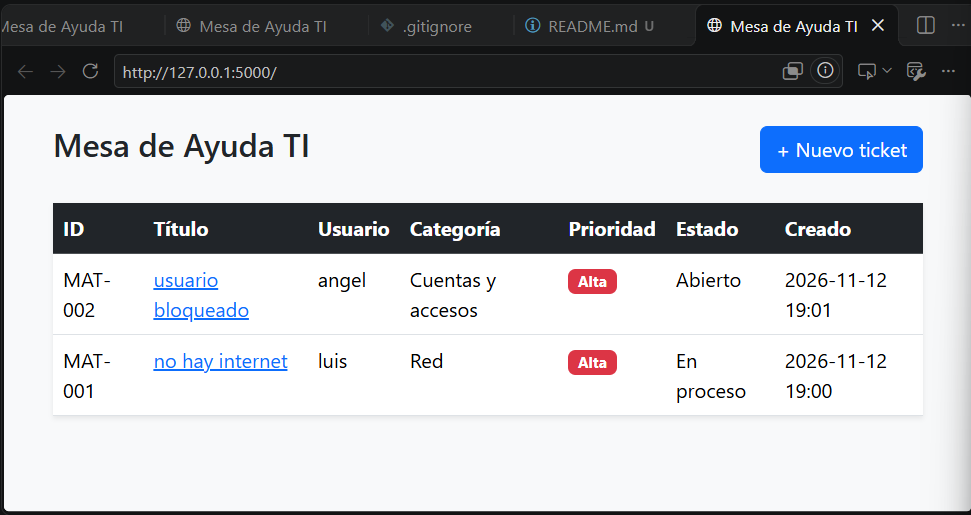
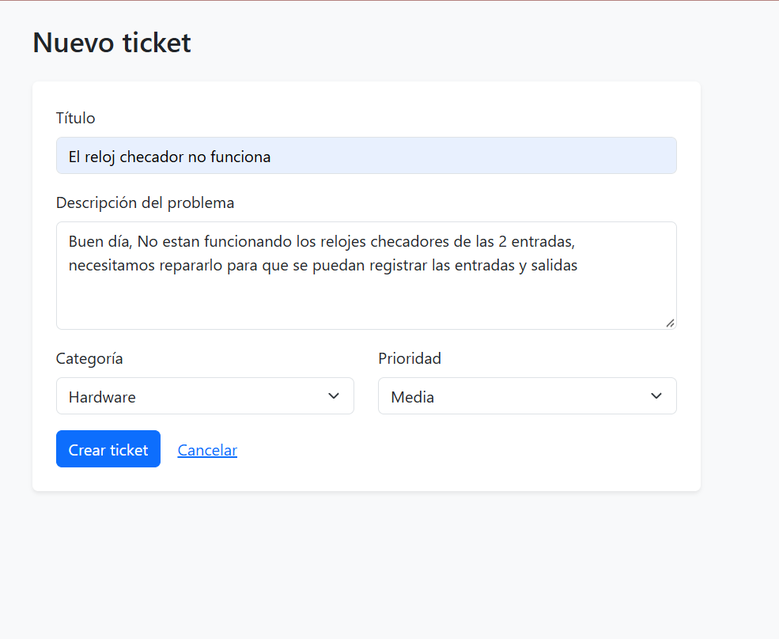
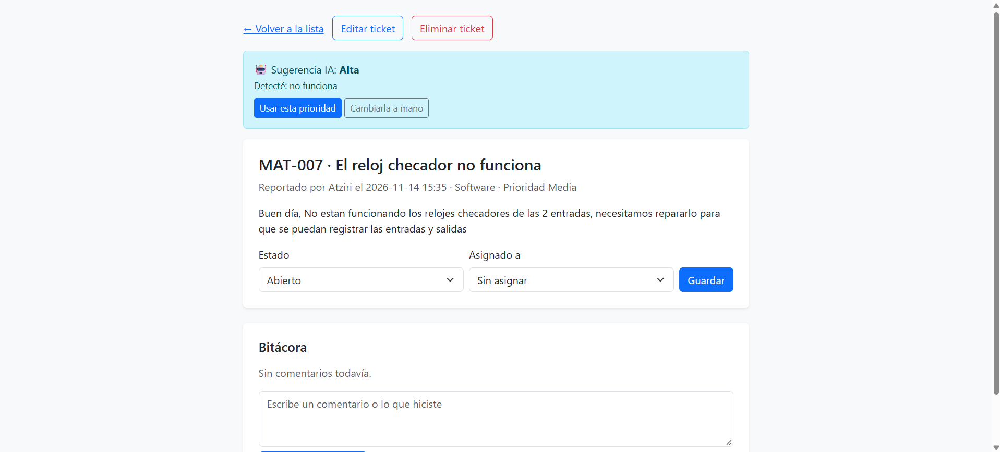

# Mesa de Ayuda TI

Sistema web de gestión de tickets para soporte técnico (Helpdesk L1), hecho con **Python, Flask y SQLite**.

Proyecto personal desarrollado durante el bootcamp de Helpdesk IT y Redes de Generation México (2026) para practicar el ciclo de vida de un incidente: registro, priorización, asignación, seguimiento y cierre.



## Funcionalidades

- Crear tickets con título, descripción, usuario, categoría y prioridad
- Lista de tickets con folio automático (MAT-001, MAT-002…) y prioridad por color
- Vista de detalle de cada ticket
- Cambio de estado: Abierto → En proceso → Resuelto → Cerrado
- Asignación de técnico
- Bitácora de comentarios por ticket
- Registro automático de cada cambio de estado o asignación

## Capturas

| Nuevo ticket | Detalle y bitácora |
|---|---|
|  |  |

## Tecnologías

- Python 3
- Flask (servidor web y rutas)
- SQLite (base de datos)
- HTML, Jinja2 y Bootstrap 5 (interfaz)
- Git y GitHub (control de versiones)

## Cómo ejecutarlo

```bash
git clone https://github.com/luisavalos12/mesa-ayuda.git
cd mesa-ayuda
python -m venv venv
venv\Scripts\activate        # En Windows
# source venv/bin/activate   # En Linux o Mac
pip install -r requirements.txt
python app.py
```

Abre en el navegador la dirección local que muestra la terminal (puerto 5000). La base de datos `tickets.db` se crea sola la primera vez.

## Estructura

```
mesa-ayuda/
├── app.py              # Rutas y lógica
├── requirements.txt    # Dependencias
├── templates/
│   ├── index.html      # Lista de tickets
│   ├── nuevo.html      # Formulario de alta
│   └── detalle.html    # Detalle, estado y bitácora
└── docs/               # Capturas
```

## Próximas mejoras

- [ ] Inicio de sesión para técnicos
- [ ] Tablero con totales por estado y prioridad
- [ ] Control de SLA y tickets vencidos
- [ ] Filtros y búsqueda

## Autor

**Luis Jorge García Avalos** · Soporte TI y Redes  
LinkedIn: https://www.linkedin.com/in/luis-avalos1204