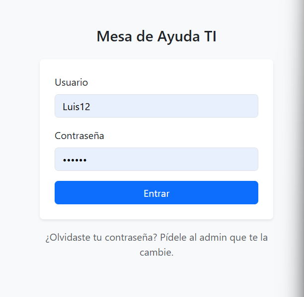
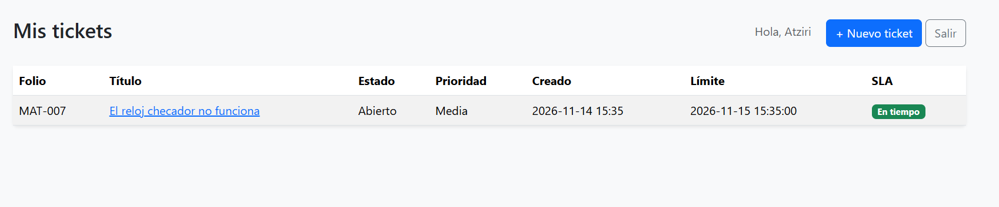
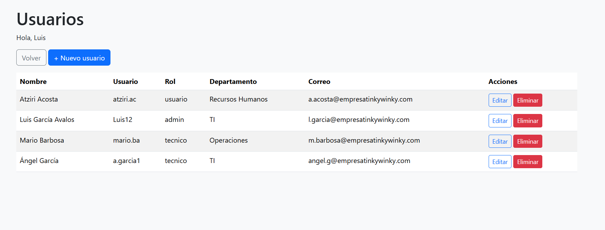

# Mesa de Ayuda TI

Sistema web de gestión de tickets para soporte técnico (Helpdesk L1), hecho con **Python, Flask y SQLite**.

Proyecto personal desarrollado durante el bootcamp de Helpdesk IT y Redes de Generation México (2026) para practicar el ciclo de vida de un incidente: registro, priorización, asignación, seguimiento, SLA y cierre.


## Funcionalidades

### Roles
| Rol | Qué puede hacer |
|---|---|
| **Admin (maestro)** | Todo lo del técnico, más registrar, editar y eliminar usuarios |
| **Técnico** | Ver, filtrar, editar, asignar, cerrar y eliminar tickets; exportar a CSV |
| **Usuario de departamento** | Levantar tickets y ver solo los suyos en "Mis tickets" |

### Tickets
- Alta de tickets con título, descripción, categoría y prioridad (también sin cuenta)
- Folio automático (MAT-001, MAT-002…) y aviso de confirmación
- Estados: Abierto → En proceso → Resuelto → Cerrado
- Asignación a técnicos registrados
- Edición y eliminación de tickets
- Bitácora de comentarios firmada con el usuario en sesión
- Registro automático de cada cambio de estado o asignación

### Tablero y seguimiento
- Totales por estado y por prioridad
- Filtros por estado, prioridad y categoría, y búsqueda por texto
- Orden por fecha o por prioridad
- **SLA por prioridad:** Alta 8 h, Media 24 h, Baja 72 h
- Marca y alerta de tickets vencidos
- Exportación de tickets a CSV

### Sugerencia de prioridad (IA basada en reglas)
- Analiza título y descripción en busca de palabras clave ("urgente", "sin internet", "bloqueado", "lento", "error"…)
- Sugiere Alta, Media o Baja y explica qué detectó
- El técnico puede aplicar la sugerencia con un clic

### Usuarios y seguridad
- Inicio y cierre de sesión; páginas protegidas por rol
- Contraseñas guardadas como hash (Werkzeug), nunca en texto plano
- Registro con nombre, apellidos, correo, rol y departamento
- Usuario de acceso generado automáticamente (ej. `luis.ga`) sin duplicados
- Validación de formularios y protección contra redirecciones externas
- Recuperación de contraseña a través del admin

## Capturas

| Inicio de sesión | Nuevo ticket |
|---|---|
|  |  |

| Detalle con sugerencia IA | Mis tickets (usuario) |
|---|---|
|  |  |

| Gestión de usuarios (admin) |
|---|
|  |

## Tecnologías

- Python 3
- Flask (rutas, sesiones y roles)
- Werkzeug (hash de contraseñas)
- SQLite (base de datos)
- HTML, Jinja2 y Bootstrap 5 (interfaz)
- PyInstaller (ejecutable para Windows)
- Git y GitHub (control de versiones)

## Cómo ejecutarlo

### Opción 1: ejecutable para Windows
Descarga `dist/MesaAyudaTI.exe`, ábrelo y entra a la dirección local que muestra la consola (puerto 5000).

### Opción 2: desde el código

```bash
git clone https://github.com/luisavalos12/mesa-ayuda.git
cd mesa-ayuda
python -m venv venv
venv\Scripts\activate        # En Windows
# source venv/bin/activate   # En Linux o Mac
pip install -r requirements.txt
```

Crea la primera cuenta (la contraseña no se ve al escribir):

```bash
python crear_usuario.py
```

Conviértela en admin (cambia `luis` por el usuario que elegiste):

```bash
python -c "import sqlite3; c=sqlite3.connect('tickets.db'); c.execute(\"UPDATE usuarios SET rol='admin' WHERE usuario='luis'\"); c.commit()"
```

Inicia la aplicación:

```bash
python app.py
```

Abre en el navegador la dirección local que muestra la terminal (puerto 5000). Desde el admin puedes registrar técnicos y usuarios de departamento. La base de datos `tickets.db` se crea sola la primera vez.

> Para producción, define la variable de entorno `SECRET_KEY` con un valor propio.

## Estructura

```
mesa-ayuda/
├── app.py                  # Rutas, roles, SLA, IA y lógica
├── crear_usuario.py        # Alta de la primera cuenta desde la terminal
├── MesaAyudaTI.spec        # Configuración de PyInstaller
├── requirements.txt        # Dependencias
├── dist/MesaAyudaTI.exe    # Ejecutable para Windows
├── templates/
│   ├── login.html          # Inicio de sesión
│   ├── index.html          # Tablero, filtros y lista de tickets
│   ├── nuevo.html          # Alta de tickets
│   ├── detalle.html        # Detalle, estado, IA y bitácora
│   ├── editar.html         # Edición de tickets
│   ├── mis_tickets.html    # Vista del usuario de departamento
│   ├── registro.html       # Alta de usuarios (admin)
│   ├── usuarios.html       # Lista de usuarios (admin)
│   └── editar_usuario.html # Edición de usuarios (admin)
└── docs/                   # Capturas
```

## Próximas mejoras

- [x] Inicio de sesión y roles
- [x] Tablero con totales por estado y prioridad
- [x] Control de SLA y tickets vencidos
- [x] Filtros y búsqueda
- [x] Sugerencia de prioridad
- [x] Exportar a CSV
- [ ] Notificaciones por correo
- [ ] Recuperación de contraseña por correo
- [ ] Gráficas de desempeño por técnico

## Autor

**Luis Jorge García Avalos** · Soporte TI y Redes  
LinkedIn: https://www.linkedin.com/in/luis-avalos1204